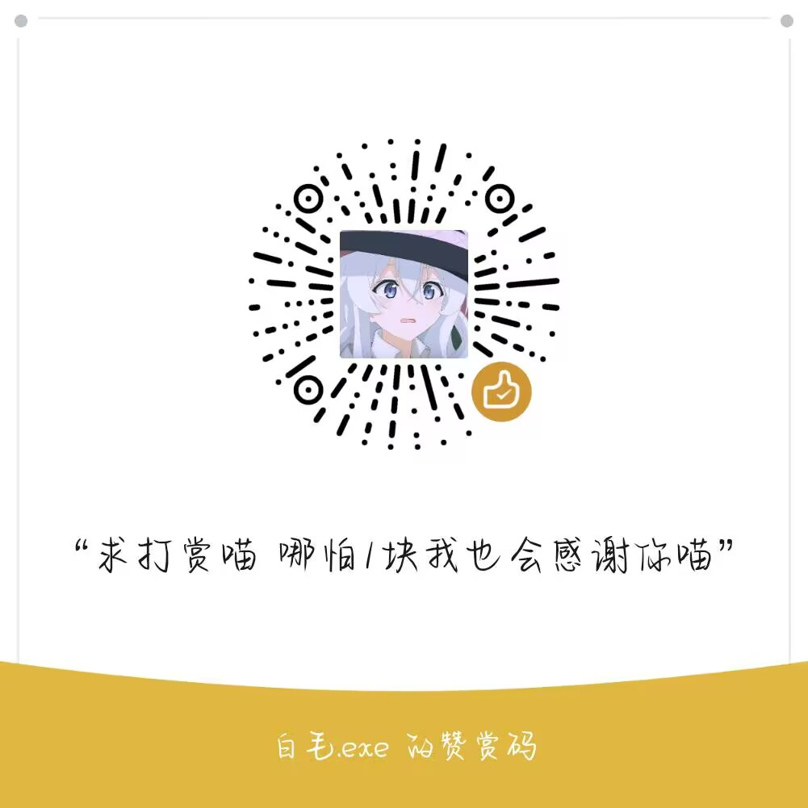

# QQMiaoMiaoAssistant

编译过了喵。  
运行挂了喵。  
所有权说这变量归我喵。  
借用检查说你先别走喵。  
生命周期说我们都活不过这个作用域喵。  
`'a` 和 `'static` 在我脑子里打起来了喵，最后 `'static` 赢了因为它活得久喵。  
我想 `clone` 一下人生喵，编译器说你的类型没实现 `Clone` 喵。  
trait object 很抽象喵，我的 `dyn` 也抽象喵。  
泛型单态化把代码膨胀了喵，我的待办也单态化成一堆具体焦虑喵。  
`impl Trait` 像许愿喵，`where` 子句像还愿喵。  
`async fn` 返回 `impl Future + Send` 喵，我跨 `.await` 持有 `MutexGuard` 被 borrow checker 当场逮捕喵。  
`Pin` 说自引用不能乱动喵，我说我也不敢动喵。  
`Send` 和 `Sync` 在会议室吵架喵，我在旁边 `unsafe impl` 装没听见喵。  
宏展开那一刻喵，我看见了宇宙的括号喵。  
模式匹配很优雅喵，`_ => todo!()` 更优雅喵。  
`unwrap()` 是程序员的勇气喵，`expect("应该不会吧")` 是程序员的遗言喵。  
零成本抽象很好喵，我的成本全在理解抽象喵。  
编译期检查很安全喵，检查完我人没了喵。  
Cargo 说依赖已解析喵，我的依赖是咖啡和自尊喵。  
Clippy 建议我改喵，我建议 Clippy 别管喵。

tokenizer 把我的话切成 token 喵，我把人生切成待办喵。  
context window 不够长喵，所以我把重要的事都放在最后喵。  
embedding 维度很高喵，我的表达维度很低喵。  
RAG 检索到十个 chunk 喵，八个无关喵，一个重复喵，一个是我昨天写的喵。  
rerank 之后知识更准了喵，我的回答更会绕了喵。  
KV cache 省了推理算力喵，没省我的精神算力喵。  
LoRA 微调了模型喵，没微调我的工资喵。  
量化到 4bit 很轻喵，我的钱包也想被量化喵。  
temperature 调高了模型更发散喵，我本来就发散喵。  
top-p 采样采出了诗意喵，eval 采出了事故喵。  
hallucination 不可怕喵，可怕的是它说得比我自信喵。  
prompt injection 一进来喵，agent 就自主地把权限交出去了喵。  
tool calling 很自主喵，自主到把我的 API key 也 call 走了喵。  
alignment 对齐了价值观喵，没对齐我的 KPI 喵。  
benchmark 跑分很高喵，线上延迟更高喵。  
吞吐上去了喵，我的吞吐是同时吐八个槽喵。  
CUDA OOM 那一刻喵，GPU 和我一起显存不足喵。  
混合精度训练很省喵，省下来的显存被日志吃了喵。  
梯度 checkpointing 省显存喵，费时间喵，时间也 OOM 喵。  
蒸馏把小模型教会了喵，没教会我下班喵。  
MoE 说只激活部分专家喵，我说我全专家都宕机喵。  
多模态能看图了喵，看不懂我的需求文档喵。  
Agent 说它能规划任务喵，规划的第一步是把我加入任务喵。  
我的职业路径是递归喵，没有基准条件喵。  
我的 bug 是分布式的喵，日志是单点的喵。  
我的测试覆盖率很高喵，覆盖不到我为什么活着喵。  
生产环境很稳定喵，稳定地复现喵。  
回滚很成功喵，成功回到了上个 bug 喵。  
这就是 Rust 加 AI 的抽象喵。  
本人程序员猫娘喵，血统带 lifetime 喵，四只健全但都在敲键盘喵，会自主呼吸喵，会独立上厕所喵，下雨会自己跑回家改 bug 喵，虚拟商品售出不发货不退款喵，生产环境出问题请找昨天的我喵。  
喵门喵。

QQMiaoMiaoAssistant（QQ喵喵助手）是一款面向 Android QQ 的聊天辅助工具，通过系统无障碍服务提供文字改写、规则回复和 AI 自动回复，还可以搭配自定义人格、聊天记忆与悬浮球使用。

## 功能介绍

### 🐱 人设与文字改写

- 输入框停顿后自动改写草稿，也可以选择在点击发送时改写。
- 内置多种人设，支持自定义替换规则、句末语气词、颜文字和小剧场。
- 自定义改写方案可以保存多套，按聊天场景随时切换。
- 改写人设和 AI 回复人格可以分别设置，也可以让 AI 跟随改写人设。

### 💬 规则回复与 AI 自动回复

- 支持规则回复和 AI 回复，可选择规则优先、AI 优先、只用规则或只用 AI。
- 支持 DeepSeek 等兼容 OpenAI 接口格式的服务，自行配置服务地址、API 密钥和模型。
- 可设置只回复私聊、只回复群聊或同时回复；群聊支持只回 @ 和名单群自由陪聊。
- 最多合并 5 条连续未读消息生成回复，可选择拆成两条文字气泡发送。
- 支持回复间隔、每分钟回复上限、夜间模式、敏感词、黑名单和白名单。
- 提供消息去重、历史消息过滤、发送前会话检查、用户操作避让和失败暂停。

### 🎭 人格卡、聊天记忆与试聊

- 内置人格库，默认 AI 人格为蓝色大肥鱼。
- 支持新建、编辑、复制、导入和导出人格卡，最多保存 20 张。
- 可自定义自称、称呼、关系语气、表达方式、示例对话、兴趣口味和交流边界。
- 吐槽与反驳提供轻微、中等、大量三档，按喜好调整聊天风格。
- 连续试聊窗口方便预览人格效果，试聊内容不会发送到 QQ。
- 可按会话开启聊天记忆，调整保留条数，并随时查看、清空或关闭。

### 🌙 悬浮控制与运行设置

- 首页一键启动或停止，悬浮球提供快捷控制，紧急停止可立即暂停自动处理。
- 支持消息列表扫描、通知触发、定时检查和当前聊天触发。
- 提供假息屏与 Shizuku 辅助功能，以及 QQ 页面识别与异常页面恢复。
- 「基础设置喵」集中管理悬浮球、功能注释、成就提示和运行偏好。

### 🎵 彩蛋、成就与音频

- 内置彩蛋与成就墙，可调整成就提示和隐藏成就谜语显示。
- 打扰模式：启动后播放随机音频，每隔一分钟切换一段。
- 强打扰模式：随机音频完整播放后，立即接着播放下一段。
- 噪音模式：同时播放三段音频，每一路结束后分别随机续播。

### 🧰 配置与排查工具

- 支持设置导入和导出，备份人格卡、改写方案、回复规则、名单和记忆设置。
- 提供权限检查、处理历史和日志导出，方便查看运行状态与跳过原因。
- 支持定时采集 QQ 页面节点并分享采集记录，便于排查页面适配问题。
- 提供本地安装包更新入口、使用教程和 Shizuku 指引。

## 开始使用

1. 安装应用，按首页提示开启无障碍服务。
2. 在「人设与改写喵」选择人设，需要时新建自定义改写方案。
3. 使用 AI 回复时，在「自动回复喵」填写服务地址、API 密钥和模型，并设置回复范围。
4. 需要悬浮球或发送时改写时，开启悬浮窗权限；需要通知触发时，开启通知使用权。
5. 先在试聊窗口预览人格效果，再用自己的测试会话确认回复行为。
6. 回到首页点击「一键启动」，需要暂停时点击停止或紧急停止。

## 运行环境与权限

适用于 Android 7.0 及以上，主要适配标准 QQ `9.3.70 / 9.3.70.41925`。

| 权限或设置 | 用途 |
| --- | --- |
| 无障碍服务 | 读取 QQ 页面、改写输入内容和执行文字回复 |
| 悬浮窗 | 悬浮球、发送时改写和假息屏遮罩 |
| 通知使用权 | 收到 QQ 通知时触发消息处理 |
| 通知权限 | 显示运行状态与服务通知 |
| 电池优化白名单 | 减少后台服务被系统清理的情况 |
| Shizuku 授权 | 按需启用假息屏等辅助能力 |

设置、人格卡、聊天记忆和成就保存在本机。启用 AI 功能时，相关消息与上下文会发送到你自行配置的 AI 服务。配置备份不包含 API 密钥和聊天正文，换机后需要重新填写密钥；卸载前请先导出需要保留的配置。

## 🎁 赞赏与支持

核心功能永久免费。喜欢这个项目的话，欢迎点个 Star，也可以扫码请作者喝杯奶茶喵。

赞赏完全自愿，不解锁功能，也不影响自动回复、规则或 AI 的使用。

  

感谢每一份支持，喵。
